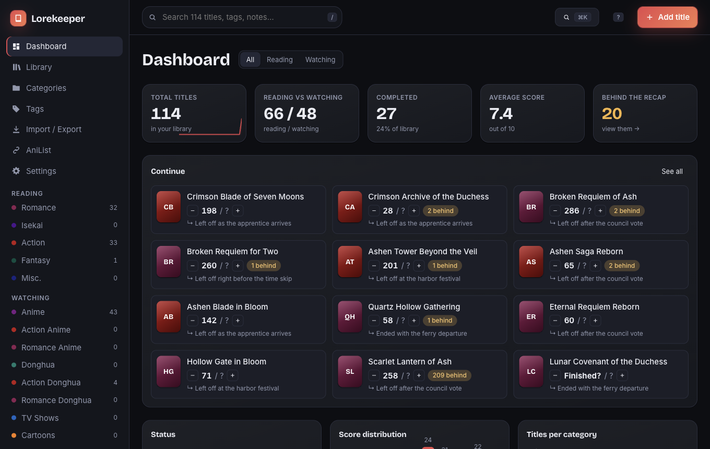
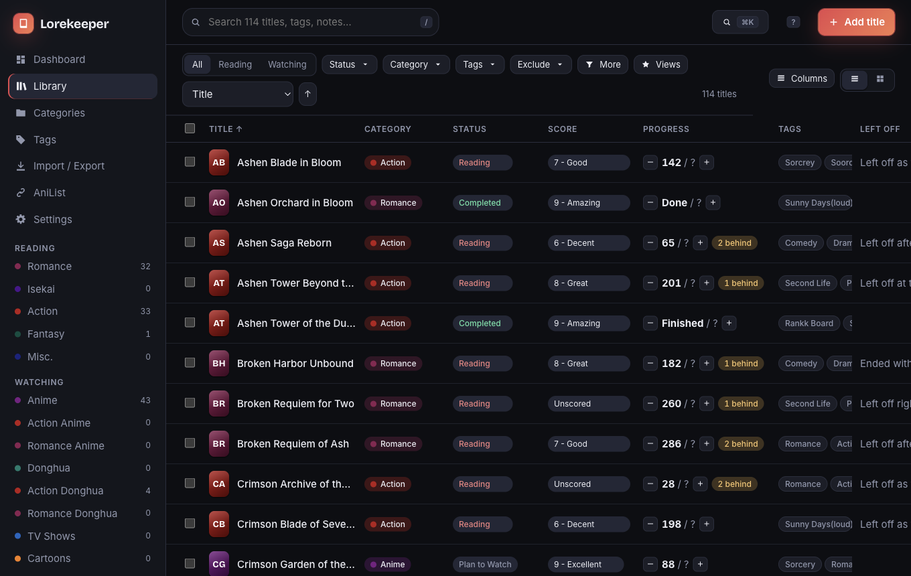
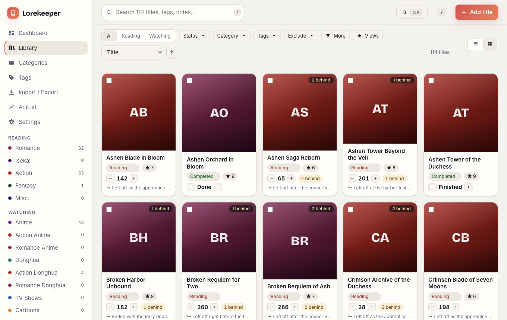
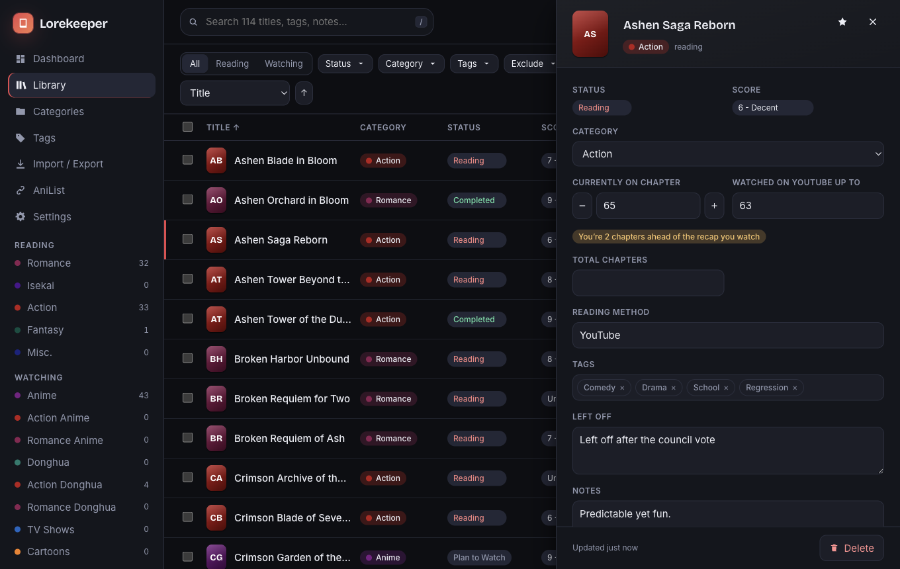
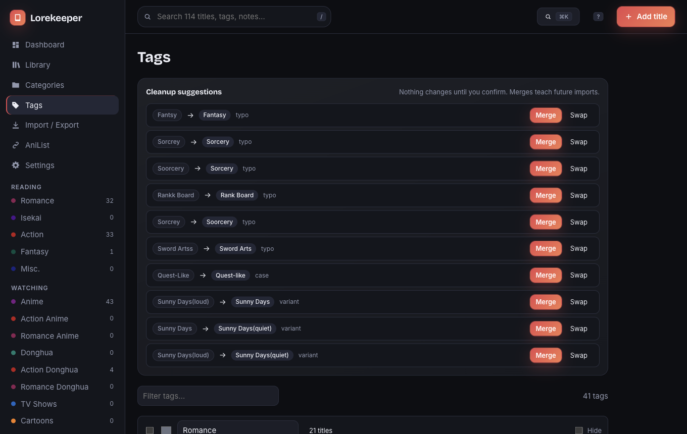

# Lorekeeper

A private, local-first tracker for everything you read and watch: manga, manhwa, manhua, anime, donghua, TV and more.
It replaces a pair of Excel workbooks with a fast desktop app, keeps your data as plain JSON files you can open and edit,
and never phones home. No accounts, no telemetry, no cloud. (The only network calls are to AniList, and only when you use
the AniList features.)



|                                                      |                                                                         |
| ---------------------------------------------------- | ----------------------------------------------------------------------- |
|  |  |
|  |                         |

_Screenshots use generated sample data only._

## What it does

- **Imports your spreadsheets.** `.xlsx` / `.xlsm` / `.csv` / `.tsv`, one sheet per category, with a mapping review, a
  warnings report and **Undo**. Re-importing is safe: titles are matched, never duplicated, and your notes are never
  overwritten by default. Messy data is handled (mixed `46` / `End of S1` / `S2 E1` / `49?` progress, scheme-less links,
  `(3/3/26) By: Channel` link text, typo'd and duplicate-case tags). The raw text is always kept next to the parsed value.
- **Library**: instant fuzzy search, tag filters (all / any / exclude), status, category, score, source, "behind the
  recap", saved views, inline editing, bulk actions, a virtualized table and a cover grid. Handles 10,000+ titles.
- **Dashboard**: stats, a _Continue_ shelf with your "left off" notes and a one-click `+1`, the gap between where you are
  and how far your recap video goes, charts, an activity heatmap, backlog and "needs a decision" lists.
- **Tags**: usage counts, rename, hide, merge, and suggested cleanups for typos and near-duplicates (never automatic).
- **AniList** (no login): matches your titles to AniList, with a review queue, cached covers and metadata, and import from
  a public account. See [docs/ANILIST.md](docs/ANILIST.md).
- **Export**: back to `.xlsx` in your original layout (colors, banner, dropdowns, round-trips losslessly), `.csv`, or a full
  JSON backup. Automatic snapshots on launch, before imports and before bulk deletes, with one-click restore.
- **Keyboard first**: `⌘/Ctrl+K` palette, `/` search, `N` new, `J`/`K` move, `E` edit, `+`/`-` progress, `?` help.
- **Accessible**: WCAG 2 AA checked automatically in both themes on every screen, visible focus, focus-trapped dialogs,
  reduced-motion respected.

## Install

Download an installer from the Releases page, or build it yourself (below). Builds are **unsigned**, so the OS will warn
you on first launch: Windows SmartScreen ("More info" → "Run anyway"), macOS Gatekeeper (right-click → Open), Linux AppImage
(`chmod +x`). Details and how to add signing later are in [docs/DISTRIBUTION.md](docs/DISTRIBUTION.md).

## Run from source

Requires Node 22+.

```bash
npm install
npm run dev            # API + web UI in a browser (http://127.0.0.1:5173)
npm run dev:desktop    # the same UI inside Electron
npm run build:desktop  # installers for your OS -> apps/desktop/release/
```

| Script                      | What it does                                                                      |
| --------------------------- | --------------------------------------------------------------------------------- |
| `npm test`                  | unit + API + importer tests (Vitest)                                              |
| `npm run e2e`               | Playwright smoke, accessibility and keyboard tests against the built Electron app |
| `npm run verify`            | lint, typecheck, tests and e2e: the same checks CI runs                           |
| `npm run perf`              | timing check with 10,000 synthetic entries                                        |
| `npm run fixtures:generate` | writes the synthetic sample workbooks to `fixtures/synthetic/`                    |
| `npm run screenshots`       | regenerates the images above                                                      |

## Where your data lives

Plain JSON in the OS app-data folder (`%APPDATA%\Lorekeeper`, `~/Library/Application Support/Lorekeeper`,
`~/.config/Lorekeeper`). Change it in Settings or with `LOREKEEPER_DATA_DIR`. Edit a file by hand while the app is running
and it reloads it; a broken edit is reported and ignored rather than loaded. See [docs/DATA_FORMAT.md](docs/DATA_FORMAT.md).

## Documentation

[Architecture](docs/ARCHITECTURE.md) · [Data format](docs/DATA_FORMAT.md) · [AniList](docs/ANILIST.md) ·
[Building & distributing](docs/DISTRIBUTION.md) · [Contributing](CONTRIBUTING.md)

## Privacy

Your library never leaves your machine. This repository is public, so personal spreadsheets are gitignored
(`private-fixtures/`) and a CI/pre-commit guard rejects any spreadsheet or CSV outside `fixtures/synthetic/`. Tests and
screenshots use invented data only.
