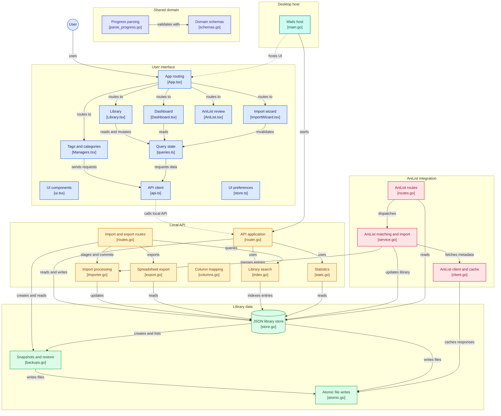

# Architecture

```
Wails window ──starts──▶ Go API (127.0.0.1:ephemeral, bearer token) ──▶ Store (in-memory truth) ──▶ JSON files
      │ injected bridge script (token + base URL)                      ▲ fsnotify reloads hand edits, SSE /events
      └──▶ React UI in the system webview (talks only to /api/v1)
```

- `apps/web`: React UI (TanStack Query for server state, Zustand for UI state), talks only to `/api/v1`.
- `packages/shared`: Zod schemas, constants and pure parsers the UI uses.
- `go/internal/shared`: schemas, constants and parsers (progress, links, tags, titles, status, score) for the backend.
- `go/internal/store`: atomic IO, backups, migrations and the `Store`; `search` (MiniSearch-compatible index and filters),
  `stats`, `api` (router, auth, SSE) and `routes`, `importexport` (spreadsheet reading, import planner/commit/undo, exporters).
- `go/internal/anilist`: rate-limited, cached, cancellable AniList client; matcher; review queue; account import.
- `go/internal/desktop`: the shell core that needs no window (paths, single-instance lock, window state, bridge, menu);
  `go/cmd/lorekeeper` is the thin Wails glue and `go/cmd/server` the headless API used for development and e2e.
  See `docs/DISTRIBUTION.md`.

The Go backend replaced an Electron + Node one; `docs/go-port` records how it was built and checked against it.

## Performance notes

Measured on 10,000 entries (`PERF=1 go test -run TestPerf -v ./internal/...`; full tables in `docs/go-port/phase-3.md`):
first search (builds the index) 60-155 ms, warm search 1-3 ms (fuzzy and prefix too), stats 6-13 ms, one persisted edit
53-63 ms. The search index updates incrementally by object identity instead of rebuilding, the UI renders only the visible rows
(virtualized) and pages the API 200 at a time, and typing in the search box is debounced 120 ms.

## Diagram


