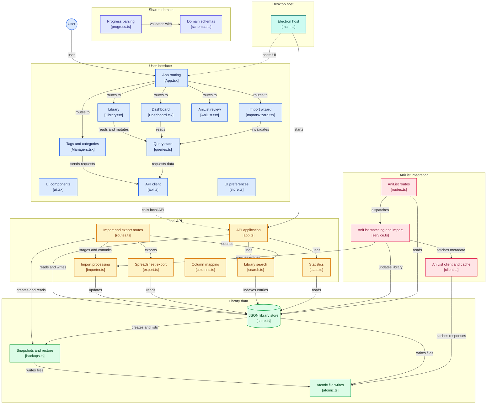

# Architecture

```
Electron main ──spawns──▶ Fastify API (127.0.0.1:ephemeral, bearer token) ──▶ Store (in-memory truth) ──▶ JSON files
      │ preload (contextBridge: token + base URL)                      ▲ chokidar reloads hand edits, SSE /events
      └──▶ React renderer (talks only to /api/v1)
```

- `packages/shared`: Zod schemas, constants, pure parsers (progress, links, tags, titles, status, score).
- `packages/server/src/anilist`: rate-limited, cached, cancellable AniList client; matcher; review queue; account import.
- `packages/server`: `storage/` (atomic IO, backups, migrations, `Store`), `search.ts` (MiniSearch + filters),
  `stats.ts`, `api/app.ts` (routes), `io/` (spreadsheet reading, import planner/commit/undo, exporters).
- `apps/web`: React UI (TanStack Query for server state, Zustand for UI state), talks only to `/api/v1`.
- `apps/desktop`: Electron main (starts the Store + API on an ephemeral port, single-instance lock, window state, native menu), sandboxed preload bridge, esbuild bundle and electron-builder config. See `docs/DISTRIBUTION.md`.

## Performance notes

Measured with `npm run perf` on 10,000 entries (laptop): cold open ~0.2 s, warm search ~1 ms (fuzzy and prefix too), title
sort of the whole library ~1 ms once cached, stats ~10 ms, and 20 concurrent progress writes coalesce into ~2 file writes
(~130 ms instead of ~1.1 s). The search index updates incrementally by object identity instead of rebuilding, the UI renders
only the visible rows (virtualized) and pages the API 200 at a time, and typing in the search box is debounced 120 ms.

## Diagram


